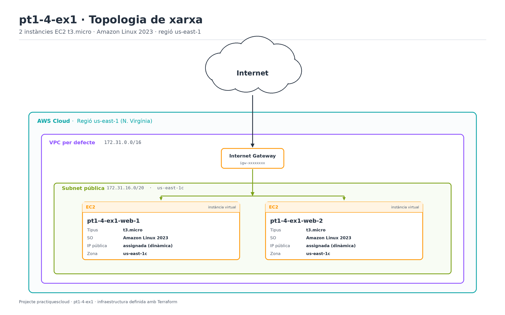

# Exercici 1 — Primeres instàncies EC2 amb Terraform

Iniciació a la Infraestructura com a Codi (IaC) amb Terraform: desplegament automàtic de
**dues instàncies EC2** amb **Amazon Linux 2023** a AWS.

| Paràmetre | Valor |
|---|---|
| Regió | `us-east-1` |
| Tipus d'instància | `t3.micro` |
| Sistema operatiu | Amazon Linux 2023 |
| Nombre d'instàncies | 2 |
| Proveïdor | `hashicorp/aws` ~> 6.0 |
| Terraform | >= 1.5 |

---

## 1. Objectiu

L'objectiu de l'exercici és perdre la por a la consola d'AWS i passar a descriure la
infraestructura en un fitxer de text versionat. Amb un sol `terraform apply` es creen les
dues instàncies; amb un `terraform destroy` desapareixen.

## 2. Topologia de xarxa



El diagrama mostra on viuen les instàncies dins d'AWS:

- **VPC per defecte (`172.31.0.0/16`)**: s'aprofita la VPC que AWS crea a cada compte
  perquè l'exercici se centri en les instàncies. Té subxarxes públiques amb sortida a
  Internet.
- **Subnet pública (`172.31.16.0/20`, `us-east-1c`)**: és on s'assignen les instàncies,
  amb IP pública pròpia. L'Availability Zone la tria AWS automàticament en crear la
  instància dins la subxarxa.
- **EC2 `pt1-4-ex1-web-1` i `pt1-4-ex1-web-2`**: les dues instàncies `t3.micro` amb
  Amazon Linux 2023.

## 3. Estructura del repositori

```
practiquescloud/
└── pt1-4-ex1/
    ├── assets/
    │   └── topologia.png      export del diagrama
    ├── README.md
    └── main.tf
```

El diagrama de la topologia es distribueix en format PNG a
[`assets/topologia.png`](assets/topologia.png).

## 4. Requisits previs

1. **Terraform >= 1.5** instal·lat (`terraform version`).
2. **Credencials d'AWS actives** al perfil `default` (`~/.aws/credentials`). Al laboratori
   d'AWS Academy cal haver iniciat la sessió i copiat les credencials temporals, que
   caduquen al cap d'unes hores.
3. **Key pair `vockey`** existent a la regió `us-east-1`. És el key pair que AWS Academy
   crea per defecte; si utilitzes un compte propi, crea'n un i passa'n el nom amb
   `-var="key_name=<nom>"`.
4. Permís per crear instàncies EC2 al compte.

## 5. El codi: `main.tf`

El fitxer s'organitza en blocs:

- **`terraform`**: fixa la versió mínima de Terraform i la del proveïdor d'AWS, de manera
  que el projecte no es trenqui quan surti una versió incompatible.
- **`provider "aws"`**: indica la regió on es desplega tot.
- **`data "aws_ami" "al2023"`**: cerca la imatge més recent d'Amazon Linux 2023 publicada
  per Amazon. És preferible a escriure un `ami-xxxx` fix, perquè els IDs d'AMI varien
  segons la regió i el temps.
- **`data "aws_vpc" "default"`**: recupera la VPC per defecte del compte.
- **`aws_instance` amb `count = 2`**: crea les dues instàncies idèntiques, amb noms
  `pt1-4-ex1-web-1` i `pt1-4-ex1-web-2`.
- **`output`**: exposa els IDs i les IPs públiques de les instàncies.

### Variables

| Variable | Valor per defecte | Descripció |
|---|---|---|
| `aws_region` | `us-east-1` | Regió on es creen els recursos |
| `instance_type` | `t3.micro` | Tipus d'instància EC2 |
| `instance_count` | `2` | Nombre d'instàncies |
| `key_name` | `vockey` | Key pair assignat a les instàncies |
| `project_tag` | `pt1-4-ex1` | Etiqueta comuna dels recursos |

Es poden sobreescriure sense tocar el codi:

```bash
terraform apply -var="instance_type=t3.small" -var="instance_count=3"
```

## 6. Procediment d'execució

### 6.1 Inicialitzar el directori

Descarrega el proveïdor d'AWS i crea el fitxer de bloqueig de versions.

```bash
cd pt1-4-ex1
terraform init
```

### 6.2 Formatar i validar

```bash
terraform fmt        # aplica el format oficial al codi
terraform validate   # comprova la sintaxi i la coherència
```

`validate` ha de respondre `Success! The configuration is valid.`

### 6.3 Planificar

```bash
terraform plan -out=tfplan
```

Mostra **què farà** Terraform sense crear res. Cal revisar que aparegui
`Plan: 2 to add, 0 to change, 0 to destroy.`

### 6.4 Aplicar

```bash
terraform apply tfplan
```

Alternativa interactiva: `terraform apply` i escriure `yes` quan ho demani. En acabar,
Terraform imprimeix els outputs:

```
Apply complete! Resources: 2 added, 0 changed, 0 destroyed.

Outputs:

ami_id       = "ami-04b938437b69a2c9c"
instance_ids = ["i-021a04d45cda3ebca", "i-0caa961a3306ffb54"]
public_ips   = ["34.227.192.134", "52.72.93.94"]
```

> Les IPs públiques canvien a cada `apply`, ja que s'assignen de manera dinàmica.

### 6.5 Verificar el desplegament

Des de la consola d'AWS (EC2 → Instances) han d'aparèixer dues instàncies `t3.micro` en
estat `running` amb l'etiqueta `Project = pt1-4-ex1`. També es pot comprovar per terminal:

```bash
terraform output instance_ids
terraform output public_ips
```

### 6.6 Destruir la infraestructura

És obligatori al final de la pràctica per no consumir crèdit del laboratori:

```bash
terraform destroy
```

Terraform demana confirmació i esborra les dues instàncies. Els outputs deixen de ser
vàlids.

## 7. Resultats de l'execució

### 7.1 Instàncies creades

```text
aws_instance.web[0]: Creation complete after 15s [id=i-021a04d45cda3ebca]
aws_instance.web[1]: Creation complete after 15s [id=i-0caa961a3306ffb54]
```

| Recurs | ID | Zona | IP privada | IP pública | Tipus |
|---|---|---|---|---|---|
| `pt1-4-ex1-web-1` | `i-021a04d45cda3ebca` | `us-east-1c` | `172.31.18.11` | `34.227.192.134` | `t3.micro` |
| `pt1-4-ex1-web-2` | `i-0caa961a3306ffb54` | `us-east-1c` | `172.31.25.118` | `52.72.93.94` | `t3.micro` |

Les dues instàncies comparteixen la subxarxa `subnet-07dc94a79b98dbf19` de la VPC per
defecte i l'AMI `ami-04b938437b69a2c9c` (Amazon Linux 2023).

## 8. Problemes habituals

| Símptoma | Causa i solució |
|---|---|
| `ExpiredToken: The security token included in the request is expired` | La sessió d'AWS Academy ha caducat. Torna a iniciar el laboratori i actualitza `~/.aws/credentials`. |
| `InvalidKeyPair.NotFound` | El key pair `vockey` no existeix a la regió. Crea'n un o passa `-var="key_name=..."`. |
| Error en triar el tipus `t3.micro` | Segons el compte, el tipus per defecte permès pot ser `t2.micro`: `-var="instance_type=t2.micro"`. |
| `SSH: Connection timed out` | El codi no defineix cap grup de seguretat: les instàncies fan servir el de la VPC per defecte, que no permet trànsit d'entrada. Si cal accedir-hi, afegeix-hi una regla per SSH des de la consola. |

## 9. Costos

Dues instàncies `t3.micro` en marxa consumeixen crèdit del laboratori mentre estan
enceses. L'exercici s'ha de tancar sempre amb `terraform destroy`; les IPs públiques no
tenen cost un cop les instàncies estan aturades o esborrades.

---

**Autor:** Tabrih · Pràctiques Cloud
