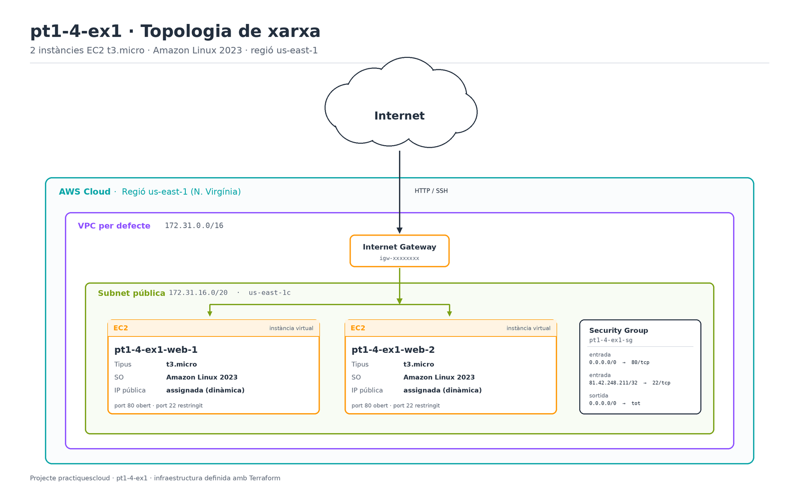

# Exercici 1 — Primeres instàncies EC2 amb Terraform

Iniciació a la Infraestructura com a Codi (IaC) amb Terraform: desplegament automàtic de
**dues instàncies EC2** amb **Amazon Linux 2023** a AWS.

| Paràmetre | Valor |
|---|---|
| Regió | `us-east-1` |
| Tipus d'instància | `t3.micro` |
| Sistema operatiu | Amazon Linux 2023 |
| Nombre d'instàncies | 2 |
| Proveïdor | `hashicorp/aws` ~> 6.0 |
| Terraform | >= 1.5 |

---

## 1. Objectiu

L'objectiu de l'exercici és perdre la por a la consola d'AWS i passar a descriure la
infraestructura en un fitxer de text versionat. Amb un sol `terraform apply` es creen les
dues instàncies, el seu grup de seguretat i la configuració de xarxa necessària; amb un
`terraform destroy` desapareix tot.

## 2. Topologia de xarxa



El diagrama mostra el camí del trànsit des d'Internet fins a les instàncies:

- **Internet → Internet Gateway**: el trànsit HTTP (port 80) i SSH (port 22) entra a la VPC
  per l'Internet Gateway associat a la VPC per defecte.
- **VPC per defecte (`172.31.0.0/16`)**: s'aprofita la VPC que AWS crea a cada compte perquè
  l'exercici se centri en les instàncies. Té subxarxes públiques amb sortida a Internet.
- **Subnet pública (`172.31.16.0/20`, `us-east-1c`)**: és on s'assignen les instàncies, amb
  IP pública pròpia perquè siguin accessibles des de fora. L'Availability Zone la tria AWS
  automàticament en crear la instància dins la subxarxa.
- **Security Group `pt1-4-ex1-sg`**: filtra el trànsit d'entrada i de sortida.
- **EC2 `pt1-4-ex1-web-1` i `pt1-4-ex1-web-2`**: les dues instàncies `t3.micro` amb Amazon
  Linux 2023 i un servidor Apache (`httpd`) desplegat amb `user_data`.

Regles del Security Group:

| Direcció | Port | Origen / destinació | Motiu |
|---|---|---|---|
| Entrada | 80/tcp | `0.0.0.0/0` | Servir la pàgina web a qualsevol client |
| Entrada | 22/tcp | `var.ssh_cidr` (`81.42.248.211/32` per defecte) | Administració per SSH, només des de la IP indicada |
| Sortida | tots | `0.0.0.0/0` | Actualitzacions de paquets i respostes HTTP |

> El valor de `ssh_cidr` és la IP pública des de la qual s'administra el laboratori. Si
> canvies de xarxa (o el router et dona una IP nova), actualitza'l amb
> `-var="ssh_cidr=<IP>/32"` o editant el `default` del `main.tf`.

## 3. Estructura del repositori

```
practiquescloud/
└── pt1-4-ex1/
    ├── assets/
    │   ├── topologia.png      export del diagrama
    │   └── topologia.drawio   font editable (draw.io / diagrams.net)
    ├── README.md
    └── main.tf
```

El diagrama es pot obrir i modificar amb [draw.io](https://app.diagrams.net) o l'aplicació
d'escriptori: `File → Open` i seleccionar `assets/topologia.drawio`. Per regenerar el PNG,
`File → Export as → PNG` amb escala `1x`.

## 4. Requisits previs

1. **Terraform >= 1.5** instal·lat (`terraform version`).
2. **Credencials d'AWS actives** al perfil `default` (`~/.aws/credentials`). Al laboratori
   d'AWS Academy cal haver iniciat la sessió i copiat les credencials temporals, que
   caduquen al cap d'unes hores.
3. **Key pair `vockey`** existent a la regió `us-east-1`. És el key pair que AWS Academy
   crea per defecte; si utilitzes un compte propi, crea'n un i passa'n el nom amb
   `-var="key_name=<nom>"`.
4. Permís per crear EC2 i Security Groups al compte.

## 5. El codi: `main.tf`

El fitxer s'organitza en blocs:

- **`terraform`**: fixa la versió mínima de Terraform i la del proveïdor d'AWS, de manera
  que el projecte no es trenqui quan surti una versió incompatible.
- **`provider "aws"`**: indica la regió on es desplega tot.
- **`data "aws_ami" "al2023"`**: cerca la imatge més recent d'Amazon Linux 2023 publicada
  per Amazon. És preferible a escriure un `ami-xxxx` fix, perquè els IDs d'AMI varien
  segons la regió i el temps.
- **`data "aws_vpc" "default"`**: recupera la VPC per defecte del compte.
- **`aws_security_group`**: defineix les regles d'entrada i sortida de la topologia.
- **`aws_instance` amb `count = 2`**: crea les dues instàncies idèntiques, amb noms
  `pt1-4-ex1-web-1` i `pt1-4-ex1-web-2`. El bloc `user_data` instal·la i arrenca Apache
  perquè les instàncies responguin per HTTP des del primer moment.
- **`output`**: exposa IDs, IPs públiques, URLs i l'ordre exacta d'SSH.

### Variables

| Variable | Valor per defecte | Descripció |
|---|---|---|
| `aws_region` | `us-east-1` | Regió on es creen els recursos |
| `instance_type` | `t3.micro` | Tipus d'instància EC2 |
| `instance_count` | `2` | Nombre d'instàncies |
| `key_name` | `vockey` | Key pair per accedir per SSH |
| `ssh_cidr` | `81.42.248.211/32` | Rang autoritzat al port 22 |
| `project_tag` | `pt1-4-ex1` | Etiqueta comuna dels recursos |

Es poden sobreescriure sense tocar el codi:

```bash
terraform apply -var="instance_type=t3.small" -var="ssh_cidr=203.0.113.10/32"
```

## 6. Procediment d'execució

### 6.1 Inicialitzar el directori

Descarrega el proveïdor d'AWS i crea el fitxer de bloqueig de versions.

```bash
cd pt1-4-ex1
terraform init
```

### 6.2 Formatar i validar

```bash
terraform fmt        # aplica el format oficial al codi
terraform validate   # comprova la sintaxi i la coherència
```

`validate` ha de respondre `Success! The configuration is valid.`

### 6.3 Planificar

```bash
terraform plan -out=tfplan
```

Mostra **què farà** Terraform sense crear res. Cal revisar que apareguin exactament
`2 to add` instàncies, `1 to add` Security Group i cap recurs a destruir.

### 6.4 Aplicar

```bash
terraform apply tfplan
```

Alternativa interactiva: `terraform apply` i escriure `yes` quan ho demani. En acabar,
Terraform imprimeix els outputs:

```
Apply complete! Resources: 3 added, 0 changed, 0 destroyed.

Outputs:

ami_id       = "ami-04b938437b69a2c9c"
instance_ids = ["i-021a04d45cda3ebca", "i-0caa961a3306ffb54"]
public_ips   = ["34.227.192.134", "52.72.93.94"]
ssh_commands = ["ssh -i ~/.ssh/vockey.pem ec2-user@34.227.192.134", ...]
urls         = ["http://34.227.192.134", "http://52.72.93.94"]
```

> Les IPs públiques canvien a cada `apply`, ja que s'assignen de manera dinàmica.

### 6.5 Verificar el desplegament

Comprovar que les instàncies responen per HTTP (el `user_data` triga un minut a acabar):

```bash
terraform output -raw urls
curl http://34.227.192.134
# <h1>pt1-4-ex1 - ip-172-31-18-11.ec2.internal</h1>
```

Connectar-s'hi per SSH (cal el fitxer `.pem` del key pair amb permisos `600`):

```bash
chmod 600 ~/.ssh/vockey.pem
ssh -i ~/.ssh/vockey.pem ec2-user@<IP_PUBLICA>
```

Un cop dins, comprovar la versió del sistema i el servei web:

```bash
grep -E '^(NAME|VERSION)=' /etc/os-release
# NAME="Amazon Linux"
# VERSION="2023"
sudo systemctl is-active httpd
# active
```

També es pot verificar des de la consola d'AWS (EC2 → Instances) que hi ha dues
instàncies `t3.micro` en estat `running` amb l'etiqueta `Project = pt1-4-ex1`.

### 6.6 Destruir la infraestructura

És obligatori al final de la pràctica per no consumir crèdit del laboratori:

```bash
terraform destroy
```

Terraform demana confirmació i esborra les instàncies i el Security Group. Els outputs
deixen de ser vàlids.

## 7. Resultats de l'execució

Desplegament verificat el 26 d'octubre de 2026 amb Terraform 1.17.0 i el proveïdor
`hashicorp/aws` 6.69.1.

### 7.1 `terraform apply`

```text
aws_security_group.web: Creation complete after 3s [id=sg-0bc1ed16884c67bd6]
aws_instance.web[0]: Creation complete after 15s [id=i-021a04d45cda3ebca]
aws_instance.web[1]: Creation complete after 15s [id=i-0caa961a3306ffb54]

Apply complete! Resources: 3 added, 0 changed, 0 destroyed.

Outputs:

ami_id       = "ami-04b938437b69a2c9c"
instance_ids = ["i-021a04d45cda3ebca", "i-0caa961a3306ffb54"]
public_ips   = ["34.227.192.134", "52.72.93.94"]
```

### 7.2 Resum dels recursos creats

| Recurs | ID | Zona | IP privada | IP pública | Tipus |
|---|---|---|---|---|---|
| `pt1-4-ex1-web-1` | `i-021a04d45cda3ebca` | `us-east-1c` | `172.31.18.11` | `34.227.192.134` | `t3.micro` |
| `pt1-4-ex1-web-2` | `i-0caa961a3306ffb54` | `us-east-1c` | `172.31.25.118` | `52.72.93.94` | `t3.micro` |
| `pt1-4-ex1-sg` | `sg-0bc1ed16884c67bd6` | — | — | — | Security Group |

Les dues instàncies comparteixen la subxarxa `subnet-07dc94a79b98dbf19` de la VPC per
defecte i l'AMI `ami-04b938437b69a2c9c` (Amazon Linux 2023).

### 7.3 Comprovació HTTP

El `user_data` instal·la i arrenca Apache; al cap d'un minut les dues IPs responen:

```text
$ curl http://34.227.192.134
<h1>pt1-4-ex1 - ip-172-31-18-11.ec2.internal</h1>

$ curl http://52.72.93.94
<h1>pt1-4-ex1 - ip-172-31-25-118.ec2.internal</h1>
```

### 7.4 Comprovació SSH

```text
$ ssh -i ~/.ssh/vockey.pem ec2-user@34.227.192.134
NAME="Amazon Linux"
VERSION="2023"
httpd: active
```

### 7.5 Captures

| Recurs | Captura |
|---|---|
| Topologia de xarxa | [`assets/topologia.png`](assets/topologia.png) |
| Font editable del diagrama | [`assets/topologia.drawio`](assets/topologia.drawio) |
| Consola EC2 amb les 2 instàncies | *(pendent: captura de pantalla de la consola)* |
| Pàgina web servida per les instàncies | *(pendent: captura del navegador)* |

## 8. Problemes habituals

| Símptoma | Causa i solució |
|---|---|
| `ExpiredToken: The security token included in the request is expired` | La sessió d'AWS Academy ha caducat. Torna a iniciar el laboratori i actualitza `~/.aws/credentials`. |
| `InvalidKeyPair.NotFound` | El key pair `vockey` no existeix a la regió. Crea'n un o passa `-var="key_name=..."`. |
| La pàgina no carrega els primers segons | El `user_data` encara s'està executant. Espera un minut i torna-ho a provar. |
| `curl` no connecta | Revisa que el Security Group tingui el port 80 obert i que la instància tingui IP pública. |
| `SSH: Connection timed out` | La IP d'origen no coincideix amb `ssh_cidr`. Actualitza la variable. |
| Error en triar el tipus `t3.micro` | Segons el compte, el tipus per defecte permès pot ser `t2.micro`: `-var="instance_type=t2.micro"`. |

## 9. Costos

Dues instàncies `t3.micro` en marxa consumeixen crèdit del laboratori mentre estan
enceses. L'exercici s'ha de tancar sempre amb `terraform destroy`; el Security Group i les
IPs no tenen cost un cop les instàncies estan aturades o esborrades.

---

**Autor:** Tabrih · Pràctiques Cloud
