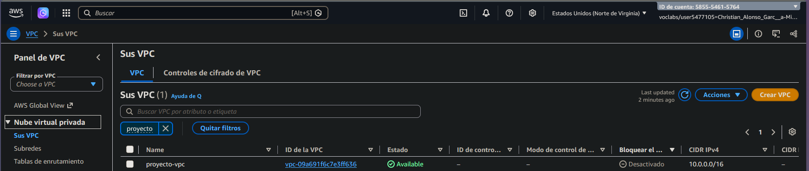
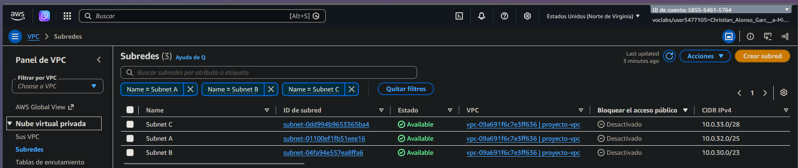
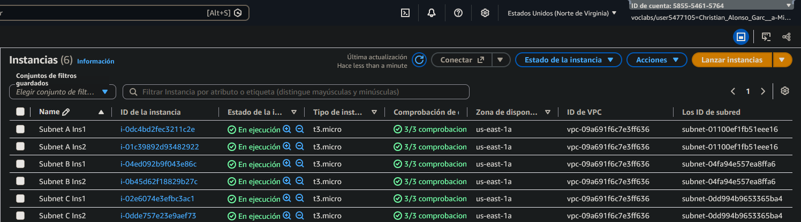
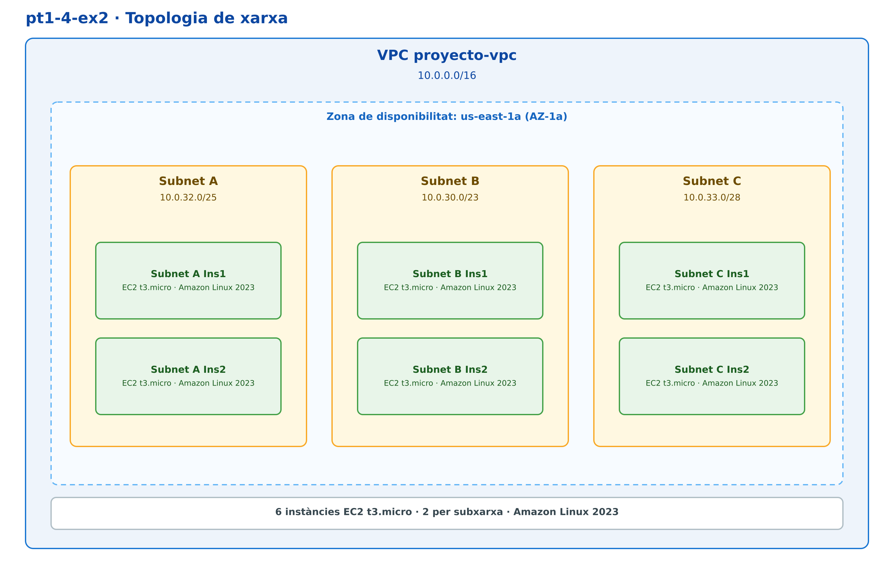

# Exercici 2 — Disseny de xarxa, consola i Terraform

Aquesta pràctica té tres parts. A la **Part A** es dissenya una xarxa personalitzada
(VPC) amb tres subxarxes dins d'una mateixa zona de disponibilitat. A la **Part B** es
desplega tota la infraestructura **manualment des de la consola d'AWS** (GUI). A la
**Part C** es reprodueix la mateixa infraestructura amb **Terraform** (IaC) i se'n
documenta la topologia amb un diagrama de draw.io.

| Paràmetre | Valor |
|---|---|
| Regió | `us-east-1` |
| Zona de disponibilitat | `us-east-1a` (AZ-1a) |
| VPC | `10.0.0.0/16` |
| Instàncies | 6 × `t3.micro` (Amazon Linux 2023) |
| Distribució | 2 instàncies per subxarxa |

---

## Part A — Disseny de xarxa

### A.1 VPC

| Recurs | Nom | CIDR |
|---|---|---|
| VPC | `proyecto-vpc` | `10.0.0.0/16` |

La VPC `/16` proporciona 65.536 adreces (`10.0.0.0` – `10.0.255.255`), espai de sobres
per encabir-hi les tres subxarxes sense solapaments.

### A.2 Subxarxes

Totes tres es creen a la **mateixa zona de disponibilitat, `us-east-1a`**:

| Subxarxa | Nom | CIDR | Rang d'adreces | Adreces útils | Instàncies |
|---|---|---|---|---|---|
| A | `Subnet A` | `10.0.32.0/25` | `10.0.32.0` – `10.0.32.127` | 123 | 2 |
| B | `Subnet B` | `10.0.30.0/23` | `10.0.30.0` – `10.0.31.255` | 507 | 2 |
| C | `Subnet C` | `10.0.33.0/28` | `10.0.33.0` – `10.0.33.15` | 11 | 2 |

> AWS reserva 5 adreces a cada subxarxa (la de xarxa, la del router, dues de DNS i la de
> broadcast). Per això una `/28` (16 adreces) deixa 11 adreces útils, més que suficients
> per a les 2 instàncies previstes.

### A.3 Topologia

```
VPC 10.0.0.0/16
│
└── us-east-1a (AZ-1a)
    ├── Subnet A  10.0.32.0/25   → 2 × EC2 t3.micro
    ├── Subnet B  10.0.30.0/23   → 2 × EC2 t3.micro
    └── Subnet C  10.0.33.0/28   → 2 × EC2 t3.micro
                                   ─────────────────
                                   6 instàncies en total
```

Les tres subxarxes no se solapen entre elles ni surten del rang de la VPC.

---

## Part B — Desplegament per consola d'AWS (GUI)

### B.0 Requisits previs

1. Sessió d'**AWS Academy Learner Lab** iniciada (les credencials són temporals).
2. Regió de treball: **N. Virginia (`us-east-1`)**.
3. **Key pair `vockey`** disponible a la regió (el crea AWS Academy per defecte).
4. Permisos per crear VPC, subxarxes i instàncies EC2.

### B.1 Crear la VPC

1. A la consola, ves a **VPC → Your VPCs → Create VPC**.
2. Selecciona **VPC only** (no «VPC and more»), per crear les subxarxes manualment.
3. Name tag: `proyecto-vpc`.
4. IPv4 CIDR block: `10.0.0.0/16`.
5. Deixa la resta de valors per defecte i prem **Create VPC**.



### B.2 Crear les tres subxarxes

Per a cada subxarxa: **VPC → Subnets → Create subnet**.

| Nom | VPC | Zona de disponibilitat | IPv4 CIDR |
|---|---|---|---|
| `Subnet A` | `proyecto-vpc` | `us-east-1a` | `10.0.32.0/25` |
| `Subnet B` | `proyecto-vpc` | `us-east-1a` | `10.0.30.0/23` |
| `Subnet C` | `proyecto-vpc` | `us-east-1a` | `10.0.33.0/28` |

1. Tria la VPC `proyecto-vpc`.
2. Subnet name: el nom de la taula.
3. Availability Zone: **`us-east-1a`** (la mateixa per a les tres).
4. IPv4 CIDR block: el CIDR corresponent.
5. Prem **Create subnet** i repeteix el procés per a les altres dues.



### B.3 Llançar les 6 instàncies EC2

Per a cada subxarxa es llancen **2 instàncies**, fins a un total de 6:

1. Ves a **EC2 → Instances → Launch instances**.
2. **Name**: `Subnet A Ins1` (i després `Subnet A Ins2`, `Subnet B Ins1`, `Subnet B Ins2`, `Subnet C Ins1` i `Subnet C Ins2`).
3. **AMI**: Amazon Linux 2023 (x86_64).
4. **Instance type**: `t3.micro`.
5. **Key pair**: `vockey`.
6. **Network settings → Edit**:
   - VPC: `proyecto-vpc`.
   - Subnet: la subxarxa corresponent (`Subnet A`, `Subnet B` o `Subnet C`).
   - Security group: deixa el grup per defecte de la VPC.
7. **Number of instances**: `2` (per crear les dues de la subxarxa alhora).
8. Prem **Launch instance**.

Repeteix el procés per a les subxarxes B i C. Si fas servir **Number of instances = 2**,
les dues instàncies comparteixen el mateix Name tag: canvia'ls el nom després des del
llistat d'instàncies perquè quedin com `Subnet A Ins1`/`Subnet A Ins2`,
`Subnet B Ins1`/`Subnet B Ins2` i `Subnet C Ins1`/`Subnet C Ins2`.

| Subxarxa | Instàncies | Tipus | SO |
|---|---|---|---|
| `Subnet A` | `Subnet A Ins1`, `Subnet A Ins2` | `t3.micro` | Amazon Linux 2023 |
| `Subnet B` | `Subnet B Ins1`, `Subnet B Ins2` | `t3.micro` | Amazon Linux 2023 |
| `Subnet C` | `Subnet C Ins1`, `Subnet C Ins2` | `t3.micro` | Amazon Linux 2023 |

### B.4 Verificar el desplegament

1. Ves a **EC2 → Instances**.
2. Filtra per **Instance state = Running**.
3. Comprova que hi ha **6 instàncies**, totes `t3.micro`, en estat **Running** i
   repartides 2 a 2 entre les tres subxarxes.
4. Revisa la columna **Subnet ID** per confirmar la distribució.



---

## Part C — Desplegament amb Terraform (IaC)

La Part C automatitza exactament la mateixa infraestructura de les parts anteriors: la
VPC `proyecto-vpc`, les tres subxarxes i les sis instàncies EC2, amb el mateix nom i la
mateixa distribució.

### C.1 Estructura dels fitxers

| Fitxer | Contingut |
|---|---|
| `versions.tf` | Versió mínima de Terraform i del proveïdor d'AWS |
| `variables.tf` | Variables configurables: regió, CIDRs, tipus d'instància, key pair… |
| `main.tf` | VPC, subxarxes, AMI d'Amazon Linux 2023 i les 6 instàncies EC2 |
| `outputs.tf` | IDs i dades de la VPC, les subxarxes i les instàncies |

### C.2 Recursos que crea

| Recurs | Nom | Detall |
|---|---|---|
| VPC | `proyecto-vpc` | `10.0.0.0/16` |
| Subxarxa | `Subnet A` | `10.0.32.0/25` · `us-east-1a` |
| Subxarxa | `Subnet B` | `10.0.30.0/23` · `us-east-1a` |
| Subxarxa | `Subnet C` | `10.0.33.0/28` · `us-east-1a` |
| Instàncies | `Subnet A Ins1`, `Subnet A Ins2` | 2 × `t3.micro` · Amazon Linux 2023 |
| Instàncies | `Subnet B Ins1`, `Subnet B Ins2` | 2 × `t3.micro` · Amazon Linux 2023 |
| Instàncies | `Subnet C Ins1`, `Subnet C Ins2` | 2 × `t3.micro` · Amazon Linux 2023 |

Les instàncies utilitzen el **grup de seguretat per defecte** de la VPC, d'acord amb
l'abast d'aquesta part de la pràctica.

### C.3 Variables

| Variable | Valor per defecte | Descripció |
|---|---|---|
| `aws_region` | `us-east-1` | Regió on es despleguen els recursos |
| `project_tag` | `pt1-4-ex2` | Etiqueta comuna dels recursos |
| `vpc_name` | `proyecto-vpc` | Nom de la VPC |
| `vpc_cidr` | `10.0.0.0/16` | Rang CIDR de la VPC |
| `availability_zone` | `us-east-1a` | Zona de disponibilitat de les tres subxarxes |
| `instance_type` | `t3.micro` | Tipus d'instància EC2 |
| `instances_per_subnet` | `2` | Instàncies creades a cada subxarxa |
| `key_name` | `vockey` | Key pair per accedir per SSH |
| `subnets` | vegeu `variables.tf` | Nom i CIDR de cada subxarxa |

Es poden sobreescriure sense tocar el codi, per exemple:

```bash
terraform apply -var="instance_type=t3.small"
```

### C.4 Procediment d'execució

```bash
cd pt1-4-ex2
terraform init        # descarrega el proveïdor d'AWS
terraform fmt         # aplica el format oficial
terraform validate    # comprova la sintaxi i la coherència
terraform plan        # mostra què es crearà sense crear res
terraform apply       # crea la VPC, les 3 subxarxes i les 6 instàncies
```

Per eliminar tota la infraestructura creada per Terraform:

```bash
terraform destroy
```

Cal tenir les credencials d'AWS actives al perfil `default` i el key pair `vockey`
disponible a `us-east-1`.

### C.5 Resultats

En acabar l'`apply`, els outputs mostren el resum de la infraestructura:

```text
instance_count = 6
vpc_id         = "vpc-..."
vpc_cidr       = "10.0.0.0/16"
subnets        = { "Subnet A" = {...}, "Subnet B" = {...}, "Subnet C" = {...} }
instances      = { "Subnet A Ins1" = {...}, ..., "Subnet C Ins2" = {...} }
ami_id         = "ami-..."
```

La configuració s'ha validat amb **Terraform 1.17.1** i el proveïdor
`hashicorp/aws ~> 6.0` (`terraform validate` respon
`Success! The configuration is valid.`).

### C.6 Diagrama de topologia

El diagrama s'ha dissenyat amb **draw.io**. El fitxer editable és
[`assets/topologia.drawio`](assets/topologia.drawio) i l'exportació en PNG és
[`assets/topologia.png`](assets/topologia.png).



Per modificar-lo, obre el `.drawio` amb [draw.io](https://app.diagrams.net) o
l'aplicació d'escriptori (`File → Open`). Per regenerar el PNG, fes
`File → Export as → PNG`.

---

## Evidències de la pràctica

| Evidència | Fitxer |
|---|---|
| VPC creada | [`assets/VPC.png`](assets/VPC.png) |
| Subxarxes dins la VPC | [`assets/subredesvpc.png`](assets/subredesvpc.png) |
| 6 instàncies EC2 en execució | [`assets/Instancias.png`](assets/Instancias.png) |
| Topologia (font editable) | [`assets/topologia.drawio`](assets/topologia.drawio) |
| Topologia exportada | [`assets/topologia.png`](assets/topologia.png) |

---

## Neteja dels recursos

Per no consumir crèdit del laboratori, un cop acabada la pràctica:

1. **EC2 → Instances**: selecciona les 6 instàncies → **Instance state → Terminate**.
2. **VPC → Subnets**: elimina les tres subxarxes.
3. **VPC → Your VPCs**: elimina `proyecto-vpc`.

> L'ordre importa: no es pot eliminar una VPC mentre tingui subxarxes o altres recursos
> associats.

Si has desplegat la **Part C** amb Terraform, no cal fer res d'això a mà: executa
`terraform destroy` dins `pt1-4-ex2` i s'eliminen la VPC, les subxarxes i les instàncies
alhora.

---

## Problemes habituals

| Símptoma | Causa i solució |
|---|---|
| El CIDR de la subxarxa és rebutjat | El rang ha de cabre dins `10.0.0.0/16` i no pot solapar-se amb una altra subxarxa. |
| No apareix `us-east-1a` al desplegable | La VPC pot estar en una altra regió: comprova que ets a `us-east-1`. |
| `InvalidKeyPair.NotFound` en llançar la instància | El key pair `vockey` no existeix a la regió; crea'n un o selecciona'n un altre. |
| No puc eliminar la VPC | Encara té subxarxes o altres recursos associats; elimina'ls primer. |
| `terraform apply` falla amb `ExpiredToken` | La sessió d'AWS Academy ha caducat: torna a iniciar el laboratori i actualitza les credencials. |
| Terraform diu que la subxarxa ja existeix | Hi ha recursos de la Part B creats a mà amb el mateix CIDR; destrueix-los o canvia el rang abans d'aplicar. |

---

**Autor:** Tabrih · Pràctiques Cloud
