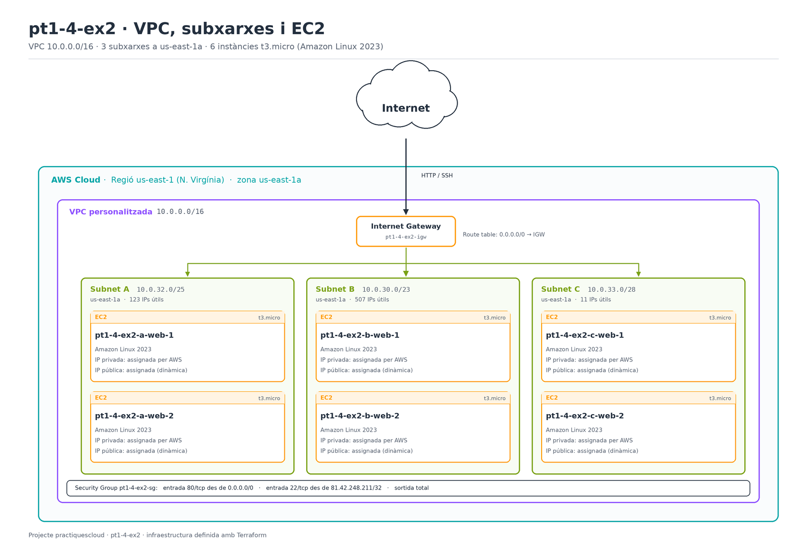

# Exercici 2 — Part C: Desplegament amb Terraform

Aquesta part correspon a la **Part C** de l'exercici: desplegament automatitzat amb Terraform d'una VPC pròpia, 3 subxarxes a la mateixa zona de disponibilitat i 6 instàncies EC2.

## Objectiu

Crear amb Terraform la infraestructura següent:

- VPC: `10.0.0.0/16`
- 3 subxarxes a `us-east-1a`:
  - `Subnet A`: `10.0.32.0/25`
  - `Subnet B`: `10.0.30.0/23`
  - `Subnet C`: `10.0.33.0/28`
- 2 instàncies EC2 `t3.micro` amb Amazon Linux 2023 per subxarxa → **6 instàncies totals**
- Internet Gateway, taula de rutes, Security Group

## Topologia



## Estructura

```
pt1-4-ex2/
├── assets/
│   ├── topologia.png
│   ├── vpc_subnets.png
│   └── ec2_instances.png
├── README.md
└── main.tf
```

## Execució

```bash
cd pt1-4-ex2
terraform init
terraform fmt
terraform validate
terraform plan -out=tfplan
terraform apply tfplan
```

## Verificació

```bash
terraform output instances
terraform output urls
```

Cada instància servirà una pàgina web amb el seu nom.

## Destrucció

```bash
terraform destroy
```
