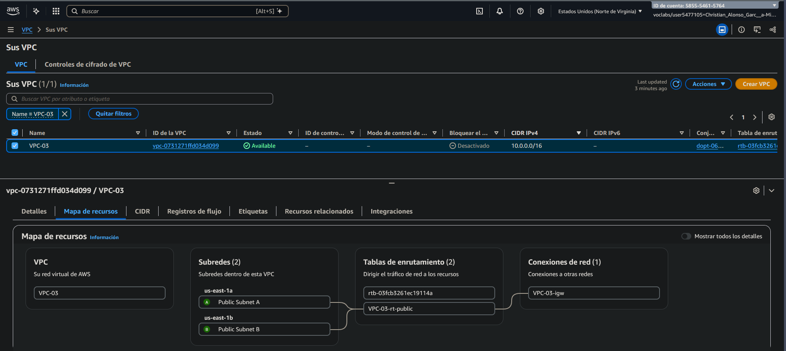
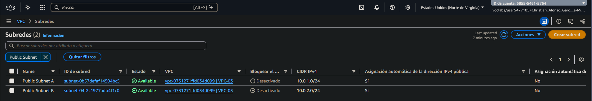
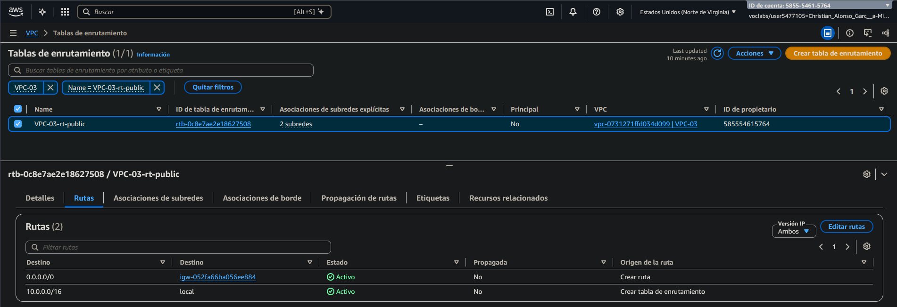
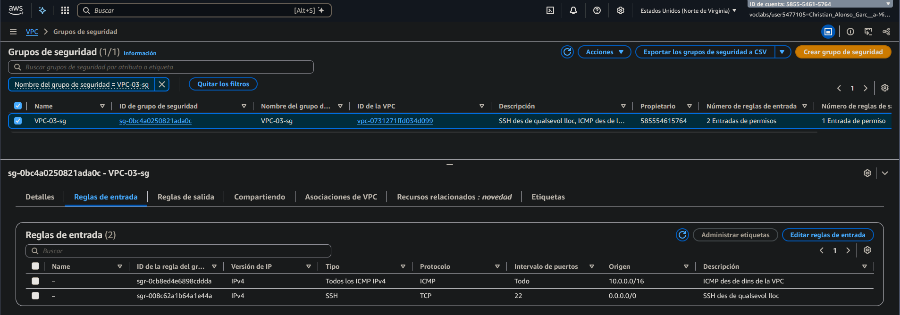
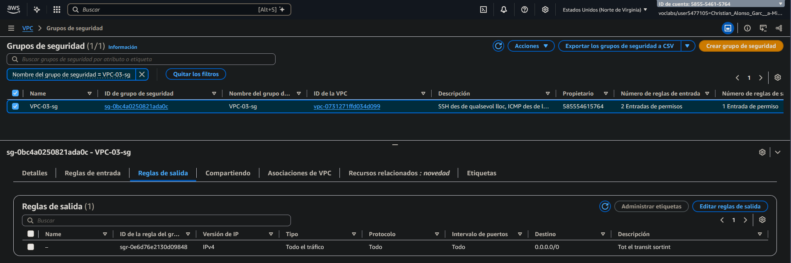
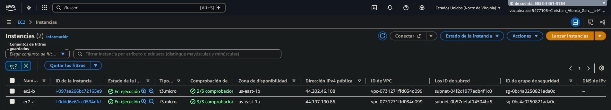

# pt2-2 — Infraestructura bàsica a AWS amb Terraform

VPC pròpia amb dues subxarxes públiques en zones de disponibilitat diferents, Internet
Gateway, taula de rutes pública, grup de seguretat i dues instàncies EC2.

## Recursos

| Recurs | Nom | Detall |
|---|---|---|
| VPC | `VPC-03` | `10.0.0.0/16` |
| Subxarxa pública | `Public Subnet A` | `10.0.1.0/24` a `us-east-1a` |
| Subxarxa pública | `Public Subnet B` | `10.0.2.0/24` a `us-east-1b` |
| Internet Gateway | `VPC-03-igw` | associat a `VPC-03` |
| Taula de rutes | `VPC-03-rt-public` | `0.0.0.0/0 → igw`, associada a A i B |
| Grup de seguretat | `VPC-03-sg` | SSH des de `0.0.0.0/0`, ICMP des de `10.0.0.0/16`, sortida total |
| Instància EC2 | `ec2-a` | `t3.micro`, Amazon Linux, key pair `vockey`, a `Public Subnet A` |
| Instància EC2 | `ec2-b` | `t3.micro`, Amazon Linux, key pair `vockey`, a `Public Subnet B` |

Les dues subxarxes tenen `map_public_ip_on_launch = true`, de manera que les instàncies
reben IP pública en el moment del desplegament.

## Estructura

```
pt2-2/
├── assets/        imatges de la pràctica
├── README.md
├── providers.tf   versió de Terraform, proveïdor d'AWS i AMI
├── main.tf        VPC, subxarxes, Internet Gateway i taula de rutes
├── security.tf    grup de seguretat
└── ec2.tf         les dues instàncies
```

## Requisits

- Terraform >= 1.5
- Credencials d'AWS actives al perfil `default`
- Key pair `vockey` a `us-east-1`

## Execució

```bash
cd pt2-2
terraform init
terraform fmt
terraform validate
terraform plan
terraform apply
```

## Verificació

```bash
terraform state show aws_instance.ec2_a | grep public_ip
```

Des de la consola: EC2 → Instances, hi ha d'haver `ec2-a` i `ec2-b` en estat `running`,
cada una en una subxarxa diferent.

Connexió per SSH:

```bash
ssh -i ~/.ssh/vockey.pem ec2-user@<IP_PUBLICA>
```

El grup de seguretat permet ICMP entre instàncies de la VPC, així que des de `ec2-a` es pot
fer `ping` a la IP privada de `ec2-b`:

```bash
ping -c 3 10.0.2.x
```

## Captures
**VPC:**



**Subxarxes:**



**Taula d'enrutament:**



**Security Group:**





**Instàncies:**




